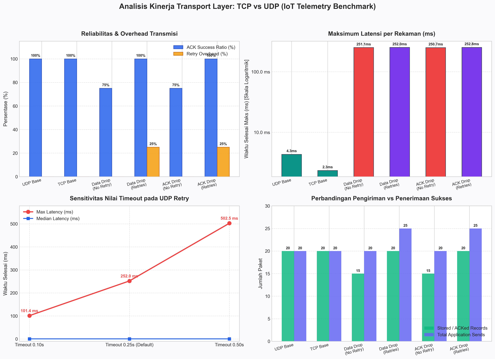

# 📡 IoT Transport Layer: TCP vs. UDP Telemetry & Reliability Lab

[](https://www.python.org/)
[](https://ugm.ac.id/)
[](https://ugm.ac.id/)
[](#-latar-belakang--tujuan)
[](#-lisensi--hak-cipta)

Repositori ini memuat implementasi, dataset hasil eksperimen, visualisasi performa, serta analisis komprehensif mengenai karakteristik protokol **Transmission Control Protocol (TCP)** dan **User Datagram Protocol (UDP)** dalam telemetri sistem **Internet of Things (IoT)**. Eksperimen mencakup mekanisme **TCP Message Framing**, simulasi kegagalan jaringan (**Data Loss** dan **ACK Loss**), perancangan **Application-Level Reliability (Stop-and-Wait ARQ)**, analisis sensitivitas **Timeout**, serta inspeksi header paket menggunakan `tcpdump`.

---

## 👥 Tim Penyusun

Praktikum ini disusun oleh mahasiswa Departemen Ilmu Komputer dan Elektronika, Fakultas MIPA, Universitas Gadjah Mada:

| Nama Mahasiswa | NIM | Peran Utama |
| :--- | :--- | :--- |
| **Ridlo Fanata Wicaksana** | `26/591572/NPA/20034` | Eksperimen Framing, Desain Protokol Telemetri, Dokumentasi |
| **Javier Gavra Abhinaya** | `26/592020/NPA/20050` | Pengujian Fault Injection, Logging CSV, Analisis Metrik |
| **Nur Alif Maulana Syafrudin** | `26/591608/NPA/20042` | Inspeksi Header tcpdump, Evaluasi Timeout, Validasi Hasil |

---

## 🎯 Latar Belakang & Tujuan

Dalam arsitektur IoT, perangkat sensor berdaya rendah sering kali beroperasi pada kanal nirkabel yang tidak stabil dan rentan terhadap kehilangan paket. Pemilihan protokol transport menentukan efisiensi daya, latensi transmisi, dan integritas data telemetri:

1. **TCP (Connection-Oriented, Byte-Stream)**: Menjamin transmisi andal dan berurutan via retransmisi internal tingkat OS. Namun, jaminan TCP berakhir di buffer socket penerima dan tidak menjamin logika aplikasi berhasil memproses pesan. Selain itu, TCP memiliki overhead 3-way handshake dan tidak menjaga batasan pesan (*message boundary*).
2. **UDP (Connectionless, Datagram-Based)**: Sangat ringan tanpa overhead koneksi, menjaga batasan pesan per datagram, namun tidak memiliki mekanisme retransmisi maupun jaminan urutan data.
3. **Application-Level Reliability**: Melalui implementasi konfirmasi balik (**ACK**) dan pembatasan percobaan ulang (**Bounded Retry / Stop-and-Wait ARQ**) di lapisan aplikasi, perangkat IoT berbasis UDP dapat mencapai reliabilitas 100% dengan overhead yang terkendali.

### Capaian Pembelajaran:
- [x] Mengidentifikasi port transport dan socket interface pada lingkungan Linux.
- [x] Membedakan karakteristik data *stream of bytes* TCP dengan *discrete datagrams* UDP.
- [x] Mengimplementasikan teknik *Message Framing* (delimiter baris baru) pada stream TCP.
- [x] Mengembangkan mekanisme *Stop-and-Wait ACK & Retry* pada lapisan aplikasi.
- [x] Menangani masalah deduplikasi data (*duplicate suppression*) saat terjadi *ACK Drop*.
- [x] Mengevaluasi trade-off latensi akibat pemilihan nilai timeout retransmisi.

---

## 🗂️ Struktur Direktori

Repositori ini telah diatur ke dalam struktur modular yang rapi dan terstandarisasi:

```text
transport-layer/
├── .gitattributes                  # Konfigurasi normalisasi end-of-line Git (LF)
├── .gitignore                      # Daftar file sementara, cache, dan capture yang diabaikan
├── README.md                       # Dokumentasi utama proyek dan ringkasan eksperimen
├── docs/                           # Dokumentasi resmi dan laporan praktikum
│   ├── Laporan_Praktikum_Transport_Layer.docx    # Laporan lengkap versi Microsoft Word
│   ├── Transport_Layer-Ridlo_Fanata_Wicaksana.pdf # Laporan praktikum final versi PDF
│   ├── Tutorial_Transport_Layer.pdf              # Modul panduan lab praktikum resmi
│   └── assets/                     # Visualisasi dan diagram penunjang
│       └── benchmark_comparison.png              # Grafik komparasi performa eksperimen
├── data/                           # Dataset hasil eksekusi pengujian (CSV)
│   ├── tcp_baseline.csv            # Pengujian baseline TCP (20 pesan telemetri)
│   ├── udp_baseline.csv            # Pengujian baseline UDP tanpa gangguan
│   ├── udp_drop.csv                # Simulasi UDP Data Drop tanpa retry (loss 25%)
│   ├── udp_retry.csv               # Simulasi UDP Data Drop dengan retry (timeout 0.25s)
│   ├── ack_drop.csv                # Simulasi UDP ACK Drop tanpa retry
│   ├── ack_retry.csv               # Simulasi UDP ACK Drop dengan retry
│   ├── udp_retry_t010.csv          # Evaluasi UDP Retry dengan timeout pendek (0.10s)
│   ├── udp_retry_t050.csv          # Evaluasi UDP Retry dengan timeout panjang (0.50s)
│   ├── tcp_headers.csv             # Data telemetri saat inspeksi paket tcpdump (TCP)
│   └── udp_headers.csv             # Data telemetri saat inspeksi paket tcpdump (UDP)
└── src/                            # Kode sumber program Python (Standard Library)
    ├── framing_demo.py             # Demonstrasi batas pesan TCP vs chunk recv()
    ├── transport_lab.py            # Engine pengujian telemetri IoT (klien & server)
    └── analyze_results.py          # Skrip otomatis pembaca data CSV dan generator grafik
```

---

## 🔬 Ringkasan Eksperimen & Analisis Teknis

### 1. Eksperimen 1: TCP Message Framing
Pada TCP, pemanggilan `sendall()` sebanyak dua kali oleh pengirim tidak menjamin dua kali pemanggilan `recv()` yang terpisah pada penerima. TCP memperlakukan data sebagai aliran byte tak terputus.

```text
[Klien]
  sendall(b"temperature=25\n") ──┐
  sendall(b"humidity=60\n")    ──┼──► [TCP Socket Buffer] ──► [Server recv(4)]
                                 │                              ├── Chunk 1: b'temp'
                                 │                              ├── Chunk 2: b'erat'
                                 │                              ├── ...
                                 └────────────────────────────► Reassembly via '\n'
```

* **Solusi**: Menggunakan delimiter baris baru (`\n`) sebagai penanda batas rekaman (*record delimiter*). Server membaca potongan byte hingga menemukan delimiter untuk merekonstruksi pesan utuh.

---

### 2. Eksperimen 2: Baseline Telemetri (TCP vs UDP)
* **Kondisi**: Pengiriman 20 rekaman telemetri suhu berturut-turut pada lingkungan loopback lokal tanpa gangguan jaringan.
* **Hasil**: Kedua protokol mencapai **100% pengiriman sukses (20/20)**. Median latensi berkisar antara **0.738 ms** (UDP) dan **0.758 ms** (TCP). UDP beroperasi tanpa overhead pembuatan sesi koneksi, sedangkan TCP memerlukan pertukaran kontrol status sesi.

---

### 3. Eksperimen 3: Simulasi Data Loss & Mekanisme Retry
* **Fault Injection**: Server menyimulasikan hilangnya paket data setiap kelipatan ke-4 (`--drop-every 4`). Dari 20 pesan, 5 pesan (seq 4, 8, 12, 16, 20) sengaja dibuang saat pertama kali diterima.
* **Tanpa Retry (`udp_drop.csv`)**: Klien hanya menerima konfirmasi untuk **15 dari 20 pesan** (*ACK Success Ratio* = 75%).
* **Dengan Retry (`udp_retry.csv`)**: Klien mengaktifkan mekanisme retransmisi hingga 3 kali batas percobaan. Klien melakukan retransmisi setelah waktu tunggu (*timeout*) 250 ms terlewati. Seluruh 20 rekaman berhasil diterima (**Success Ratio 100%**) dengan **25 total pengiriman aplikasi** (*Retry Overhead* = 25%).

---

### 4. Eksperimen 4: Simulasi ACK Loss & Penanganan Duplikasi
* **Skenario**: Paket data sensor sampai ke server dan disimpan, namun balasan konfirmasi (ACK) dari server dibuang di jaringan.
* **Perilaku Klien**: Menganggap data belum sampai karena timeout habis, lalu mengirimkan ulang data yang sama.
* **Solusi Server**: Server melacak identitas unik transaksi menggunakan pasangan `(run_id, sequence_id)`. Saat paket retransmisi tiba, server mengenali paket sebagai `DUPLICATE`, mengabaikan penyimpanan ganda, namun tetap mengirimkan ulang ACK agar klien berhenti melakukan retransmisi.

---

### 5. Eksperimen 5: Sensitivitas Nilai Timeout Retransmisi
Pemilihan nilai timeout pada mekanisme *Stop-and-Wait* sangat berpengaruh pada durasi penyelesaian pengiriman:

| Konfigurasi Timeout | Median Latensi (ms) | Maksimum Latensi (ms) | Analisis Trade-off |
| :--- | :---: | :---: | :--- |
| **0.10 detik (100 ms)** | 0.602 ms | **101.364 ms** | Retransmisi sangat cepat; risiko *spurious retransmission* jika RTT jaringan melonjak. |
| **0.25 detik (250 ms)** | 0.604 ms | **251.996 ms** | Titik keseimbangan default yang optimal untuk jaringan lokal/IoT. |
| **0.50 detik (500 ms)** | 0.578 ms | **502.486 ms** | Konservatif; menunda recovery saat terjadi packet loss sehingga memperlambat throughput. |

---

### 6. Eksperimen 6: Inspeksi Header Jaringan via `tcpdump`
* **TCP Overhead**: Memerlukan 3-way handshake (`SYN` $\rightarrow$ `SYN-ACK` $\rightarrow$ `ACK`) untuk inisiasi, pelacakan *sequence/acknowledgment number* berukuran 32-bit, flag kontrol, serta *connection teardown* (`FIN`/`RST`). Ukuran header minimum: **20 byte**.
* **UDP Overhead**: Format header sangat ringkas (**hanya 8 byte**: Source Port, Destination Port, Length, Checksum) tanpa status koneksi.

---

## 📊 Hasil Pengujian & Visualisasi

Berikut adalah visualisasi hasil pengukuran telemetri yang dianalisis secara otomatis dari file dataset pada folder `data/`:

<p align="center">
  
</p>

### Tabel Ringkasan Metrik Lengkap

Data berikut diperoleh langsung dari pembacaan dataset 10 run eksperimen:

| Skenario Pengujian | Total Paket | ACK Diterima | App Sends | Median (ms) | Maksimum (ms) | ACK Success Ratio | Retry Overhead |
| :--- | :---: | :---: | :---: | :---: | :---: | :---: | :---: |
| **UDP Baseline** | 20 | 20 | 20 | 0.738 ms | 4.331 ms | **1.00** (100%) | **0.00** (0%) |
| **TCP Baseline** | 20 | 20 | 20 | 0.758 ms | 2.343 ms | **1.00** (100%) | **0.00** (0%) |
| **UDP Data Loss (No Retry)** | 20 | 15 | 20 | 0.510 ms | 251.104 ms | **0.75** (75%) | **0.00** (0%) |
| **UDP Data Loss (Retries)** | 20 | 20 | 25 | 0.604 ms | 251.996 ms | **1.00** (100%) | **0.25** (25%) |
| **UDP ACK Loss (No Retry)** | 20 | 15 | 20 | 0.675 ms | 250.746 ms | **0.75** (75%) | **0.00** (0%) |
| **UDP ACK Loss (Retries)** | 20 | 20 | 25 | 0.641 ms | 252.781 ms | **1.00** (100%) | **0.25** (25%) |
| **UDP Retry (Timeout 0.10s)**| 20 | 20 | 25 | 0.602 ms | 101.364 ms | **1.00** (100%) | **0.25** (25%) |
| **UDP Retry (Timeout 0.50s)**| 20 | 20 | 25 | 0.578 ms | 502.486 ms | **1.00** (100%) | **0.25** (25%) |
| **TCP (Header Capture)** | 20 | 20 | 20 | 0.657 ms | 1.054 ms | **1.00** (100%) | **0.00** (0%) |
| **UDP (Header Capture)** | 20 | 20 | 20 | 0.540 ms | 0.826 ms | **1.00** (100%) | **0.00** (0%) |

$$\text{ACK Success Ratio} = \frac{\text{Acknowledged Records}}{N}, \quad \text{Retry Overhead} = \frac{\text{Application Sends} - N}{N}$$

---

## 🚀 Panduan Menjalankan Program

### Prasyarat
* **Python 3.8+** (Hanya menggunakan pustaka bawaan standar Python: `socket`, `json`, `time`, `uuid`, `argparse`, `csv`).
* *(Opsional)* `matplotlib` untuk menghasilkan grafik ringkasan visual:
  ```bash
  pip install matplotlib
  ```

---

### 1. Menjalankan Demonstrasi TCP Framing
Buka dua terminal terpisah:

**Terminal A (Server):**
```bash
python src/framing_demo.py server
```

**Terminal B (Klien):**
```bash
python src/framing_demo.py client
```

*Amati bagaimana server menerima potongan byte melalui `recv(4)` dan menyatukannya kembali menggunakan pemisah baris baru.*

---

### 2. Menjalankan Eksperimen Telemetri (`transport_lab.py`)

#### Skenario A: Baseline UDP
```bash
# Terminal 1 - Server
python src/transport_lab.py server --protocol udp

# Terminal 2 - Klien
python src/transport_lab.py client --protocol udp --out data/udp_baseline.csv
```

#### Skenario B: Baseline TCP
```bash
# Terminal 1 - Server
python src/transport_lab.py server --protocol tcp

# Terminal 2 - Klien
python src/transport_lab.py client --protocol tcp --out data/tcp_baseline.csv
```

#### Skenario C: Simulasi Data Loss dengan Bounded Retry
```bash
# Terminal 1 - Server dengan fault injection pada data paket kelipatan 4
python src/transport_lab.py server --protocol udp --drop-every 4 --fault data

# Terminal 2 - Klien dengan 3x percobaan ulang
python src/transport_lab.py client --protocol udp --retries 3 --out data/udp_retry.csv
```

#### Skenario D: Simulasi ACK Loss dengan Bounded Retry
```bash
# Terminal 1 - Server dengan fault injection pada paket balasan ACK
python src/transport_lab.py server --protocol udp --drop-every 4 --fault ack

# Terminal 2 - Klien dengan 3x percobaan ulang
python src/transport_lab.py client --protocol udp --retries 3 --out data/ack_retry.csv
```

#### Skenario E: Pengujian Variasi Nilai Timeout
```bash
# Uji coba dengan batas waktu retransmisi 100 ms
python src/transport_lab.py client --protocol udp --retries 3 --timeout 0.10 --out data/udp_retry_t010.csv

# Uji coba dengan batas waktu retransmisi 500 ms
python src/transport_lab.py client --protocol udp --retries 3 --timeout 0.50 --out data/udp_retry_t050.csv
```

---

### 3. Analisis Hasil & Pembuatan Grafik Visual
Untuk mengolah semua file dataset di folder `data/`, mencetak tabel metrik di terminal, dan memperbarui grafik visual di `docs/assets/`:

```bash
python src/analyze_results.py
```

*Argumen tambahan yang tersedia:*
* `--data-dir <path>`: Menentukan lokasi folder data CSV kustom.
* `--output-img <path>`: Menentukan lokasi penyimpanan file gambar keluaran.
* `--no-plot`: Hanya menampilkan tabel metrik di terminal tanpa merender plot gambar.

---

## 🛠️ Tips & Troubleshooting

1. **Error `Address already in use`**:
   * Port 5005 atau 5006 masih digunakan oleh proses sebelumnya yang belum berhenti sempurna.
   * *Solusi*: Tunggu beberapa detik, hentikan proses menggunakan `Ctrl + C`, atau gunakan nomor port berbeda dengan argumen `--port <nomor_port>`.
2. **Error `ConnectionRefusedError`**:
   * Klien dijalankan sebelum server berada dalam status mendengarkan (*listening/ready*).
   * *Solusi*: Pastikan server telah mencetak pesan `READY` di terminal sebelum menjalankan klien.
3. **Izin `tcpdump` pada Linux/WSL**:
   * Menangkap lalu lintas pada antarmuka jaringan `lo` (loopback) memerlukan hak akses superuser:
     ```bash
     sudo tcpdump -i lo -nn -s 0 -w /tmp/iot_capture.pcap 'port 5005'
     ```

---

## 📚 Referensi

1. Postel, J. (1980). *User Datagram Protocol*. RFC 768, Internet Engineering Task Force (IETF).
2. Eddy, W. (2022). *Transmission Control Protocol Specification*. RFC 9293, Internet Engineering Task Force (IETF).
3. Kurose, J. F., & Ross, K. W. (2021). *Computer Networking: A Top-Down Approach* (8th ed.). Pearson.
4. Departemen Ilmu Komputer dan Elektronika, FMIPA Universitas Gadjah Mada. (2026). *Modul Praktikum Internet of Things: Laptop Lab 1 - Transport Layer*.

---

## 📄 Lisensi & Hak Cipta

Proyek dan materi praktikum ini disusun untuk keperluan edukasi dan akademik pada mata kuliah **Internet of Things**, Program Studi Ilmu Komputer, Fakultas Matematika dan Ilmu Pengetahuan Alam, **Universitas Gadjah Mada**.
